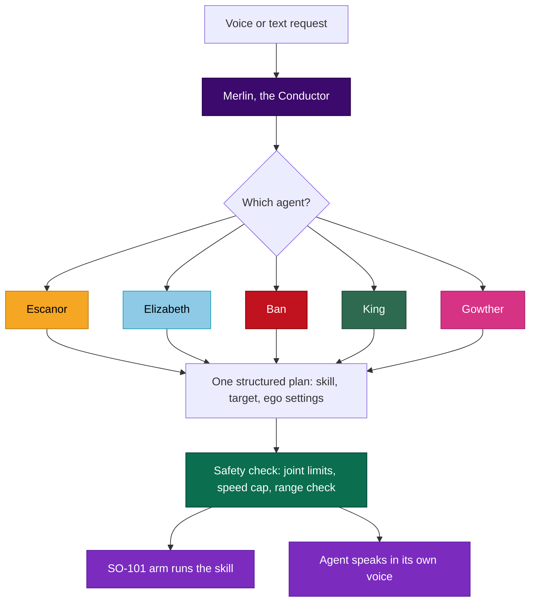

# Phantom Claw

### A third hand you can read, so you can trust it next to you.

## The problem

You can't tell what a robot arm or an AI assistant is about to do, or how sure it is. So you either watch it the whole time or you keep it away from your work.

People read each other's intent from manner. You know a careful colleague will double-check and an impatient one will rush. Phantom Claw gives a machine a manner you can read.

> [!TIP]
> Who it is for: anyone working with both hands busy or one hand unavailable. Soldering, lab work, crafting, limited mobility.

## What it is

A cast of AI agents shares one SO-101 robot arm on your desk. Each agent has a role, an ego, its own LLM and its own voice. The ego changes how the arm moves as well as what the agent says: its speed, how far it reaches and how careful it is.

The cast is a fan tribute to the Seven Deadly Sins anime, where each knight carries one sin.

| Agent | Ego | On the arm |
|---|---|---|
|  | Proud | Fetches when the job is worthy, points at it when it isn't |
|  | Caring | Slow, gentle, checks twice before gripping |
|  | Greedy and eager | Fast grabs, often before you finish asking |
|  | Lazy | The least movement that counts |
|  | Neutral | Exactly what was asked, nothing more |
|  | The Conductor | Decides who takes each job and checks the plan |

## How it works

Everything runs on one laptop. The arm plugs in over USB.

Free text never drives the arm. Every agent answers with one small structured plan, and that plan is checked before anything moves.

## What works today

- The arm picks up a bottle by the cap, holds it in the air, puts it back in the same place and folds away. It has done this run after run with the grip landing in the same spot.
- Skills are taught by hand. With the motors off, you move the arm through the job once. The arm records the joints, finds the still moments and replays them as key poses.
- Motion is one smooth blended move, with the elbow leading the shoulder so the forearm never swings into the desk.
- The wrist camera sweeps the desk to find an object and turns the arm to face it.

> [!IMPORTANT]
> Safety is the same for every agent: joint limits, a current cutoff, and a check that refuses to power a joint that reads out of range. No ego can change them.

## What we are building next

- The agent layer: OpenAI, Gemini and Claude behind one interface, with Merlin routing each request
- ElevenLabs voices, one per agent, and push-to-talk speech in
- Pixel avatars that sit on the laptop screen and show who has the arm
- Laptop work for the same agents: notes, lookups, timers, reading the screen
- Brain control with a PiEEG board: focus level and a stop signal
- Reach maths, so the arm can pick up an object anywhere in view

## Hardware

- SO-101 follower arm with six STS3215 servos, 12 V
- Wrist camera on the gripper
- A laptop

There is no leader arm, which is why every skill is taught by hand.

## AI tools used

Claude Code for planning, writing code and driving the arm during the build.

## Team

> [!NOTE]
> The agent names come from The Seven Deadly Sins. The avatars, lines and voices are our own. This project is a fan tribute and is not affiliated with the series.
