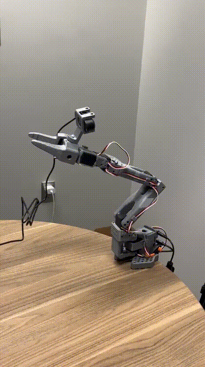
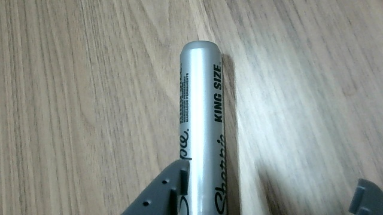
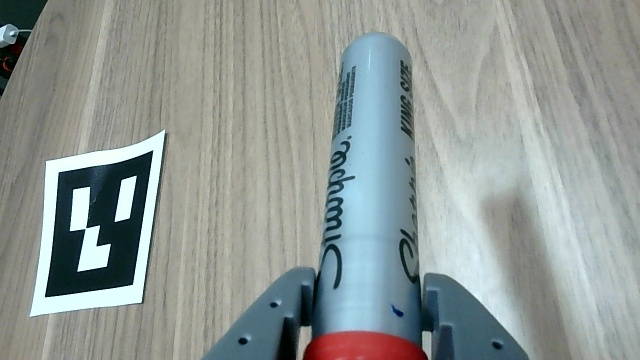

<div align="center">

# Phantom Claw

### A third hand you can read, so you can trust it next to you.

Hack The Nest 2026, Eastern Michigan University. Team The Third Hand: Sudarshan Sridhar and Aditi Dharmadhikari.



</div>

## What it is

Six characters live on the edge of your screen as pixel animals. You talk to them by name. They do work on the laptop, and they share one SO-101 robot arm on the desk. Each has its own nature, and you can see it in how the arm moves.

| Character | Animal | Nature | Model | Best at |
|---|---|---|---|---|
| Gowther | goat | plain, exact | Claude | fetching, reading the screen, facts |
| Merlin | boar | the Conductor | Claude | deciding who takes a job |
| Escanor | lion | proud | OpenAI | web search, fetching with show |
| King | bear | lazy | OpenAI | notes; points before he fetches |
| Elizabeth | sprite | caring | Gemini | timers, careful fetching |
| Ban | fox | eager | Gemini | opening apps, music |

Each character falls back to another provider if its own fails.

## What it does

On the desk, with a water bottle, a Sharpie and a pair of scissors:

1. An overhead phone camera and four ArUco markers place every item on the desk in centimetres.
2. The arm goes to the item and looks through the camera on its gripper. It turns its wrist and corrects its aim until the item sits between the jaws.
3. It picks the item up, turns to where the person is standing, and holds it out.
4. It lets go when it sees a hand or feels a pull. If nobody takes it, it puts the item back.

| The gripper camera lined up on a Sharpie | Holding it |
|---|---|
|  |  |

On the laptop: open apps and folders, web search, YouTube, music, timers, notes, screenshot, read the screen. They refuse to delete or move files, send messages, pay, type passwords, shut down or change settings. That rule is in code.

A record page shows which model answered for each character, how long it took, and every arm job. The data is stored in Tiger Data.

## Brain signals

The g.tec headsets for the Mind and Machine track did not arrive, and a PiEEG board gave no usable signal on a real head with dry pins. The software side is built: recorded brain signals from g.tec amplifiers (the BR41N.IO SSVEP set) are decoded live with canonical correlation analysis, and the decoded target asks the characters for that item. A confidence gate keeps the arm still when the signal is unclear. It is recorded data, not our own brains. See `docs/mind_and_machine.md`.

## How to talk to it

- "Phantom Claw, start" wakes it. "Phantom Claw, stop" stops the arm and sends everyone away.
- It only acts when you say a name: "Gowther, give me the Sharpie", "Ban, open Notepad", or "Phantom Claw, give me something to drink".
- Ctrl+Shift toggles listening. Ctrl+Shift+Space opens a line to type a request. Ctrl+Shift+X stops everything.

## Run it

Windows, Python 3.12, Node 20. Keys go in a `.env` file in the project folder (see `.env.example`). That file is never committed.

```
pip install -r requirements.txt
cd overlay && npm install && cd ..
.\start.ps1            # pretend arm
.\start.ps1 -RealArm   # SO-101 on COM3
.\stop.ps1
```

Every start checks the cameras, the motors, the app and the model services, in that order, before anything moves.

Tests: `python -m pytest backend\tests -q`

## Layout

| Folder | What is in it |
|---|---|
| `backend/agents` | the six characters, Merlin's routing and plan check, the request pipeline |
| `backend/arm` | arm skills: look, point, pick, place, hand over, fetch, gestures |
| `backend/vision` | cameras, the desk map from the markers, the gripper camera aim |
| `backend/listen` | wake phrase, speech to text, stop phrases |
| `backend/tools` | laptop tools and their safety rules |
| `backend/record` | the record page and the Tiger Data store |
| `backend/brain` | decoding of recorded brain signals |
| `overlay` | the pixel animals (Electron) |
| `setup` | calibration, taught grips, desk map, hand tools |
| `docs` | the build contract and write-ups |

## Built with

Python, FastAPI, OpenCV, ArUco, Claude, Gemini, OpenAI, ElevenLabs, faster-whisper, Tiger Data, Electron, SO-101.

Character names come from The Seven Deadly Sins. The pixel art, voices and lines are our own.
